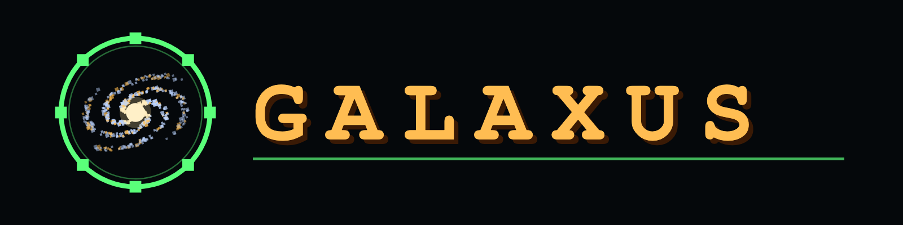

# Galaxus

Galaxus (a working title) is a space game for PC in the spirit of Frontier: Elite II, with X-Wing style flight. You're an independent captain who trades, takes jobs and picks sides in a galaxy that keeps running without you. The design brief is in [docs/design-brief.md](docs/design-brief.md).

It's built to run on almost any computer: flat-shaded low-poly models and Godot's simplest renderer, with every ship, planet, name, mission and piece of music generated from data rather than drawn or recorded.

**Play it in your browser:** [domfinn.itch.io/galaxus](https://domfinn.itch.io/galaxus). The web version is a preview: it runs more slowly than the desktop game, which you can download from the [Galaxus website](https://galaxus-game.web.app/#download). Saves move between the two.

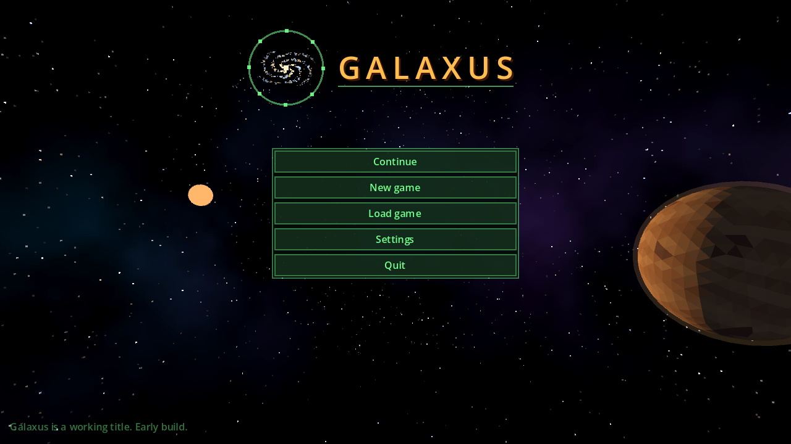

## Flying

Flight assist holds your speed and keeps you travelling where the nose points; switch it off and the drives just push. Your pilot's g-tolerance limits how hard you can turn at speed, so you turn tightest at lower throttle. Six power pips are shared between engines, shields and weapons.

Fights are dogfights. Guns swing a few degrees onto your target, and the red diamond shows where to aim. Fighters carry homing missiles: hold the target near your nose until the ring closes and turns red, then fire; when one is coming for you, the HUD marks it and beeps faster as it closes, and the answer is to turn hard. Enemy pilots take a moment to pick you up, fire in bursts, break when you get on their tail, and get better the more dangerous they are. Wingmen fly with you in battles. Difficulty (Easy, Normal, Hard) is in Settings. Lose a battle and a debrief says how close you came and why, with a tip, and offers a retry from the wave you were fighting: beaten waves stay beaten and finished objectives stay finished. V switches between the chase camera and the cockpit.

Every system has its own star and main world: gas giants with rings, airless cratered moons, ice, lava, desert, ocean and toxic worlds.

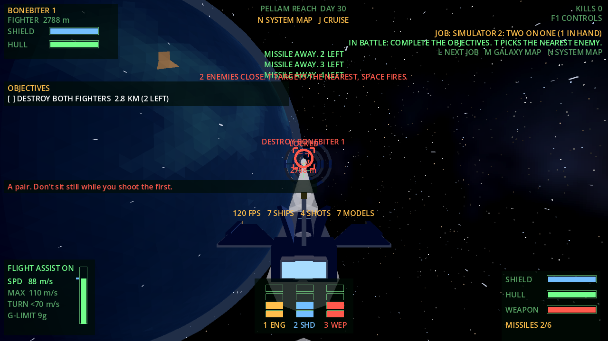

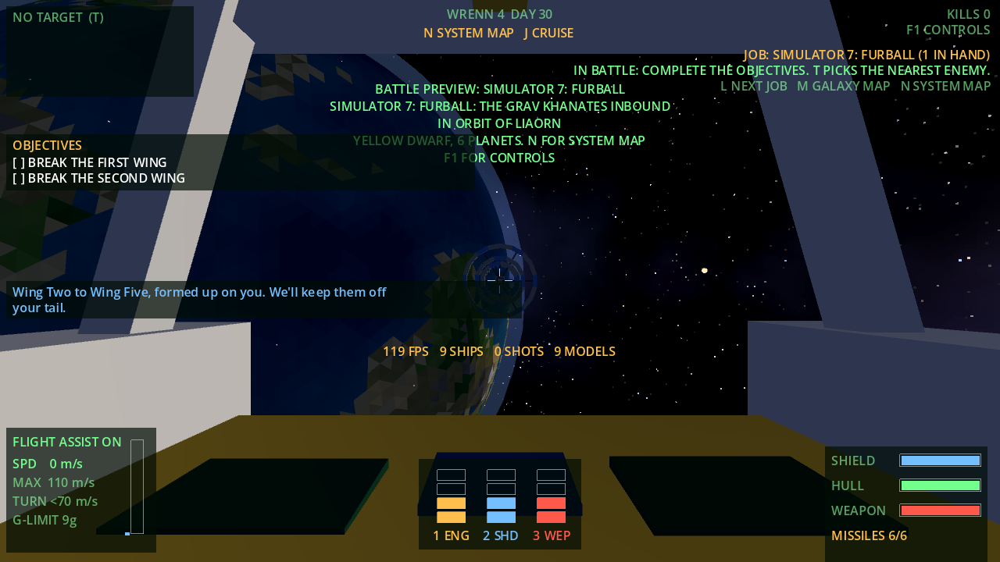

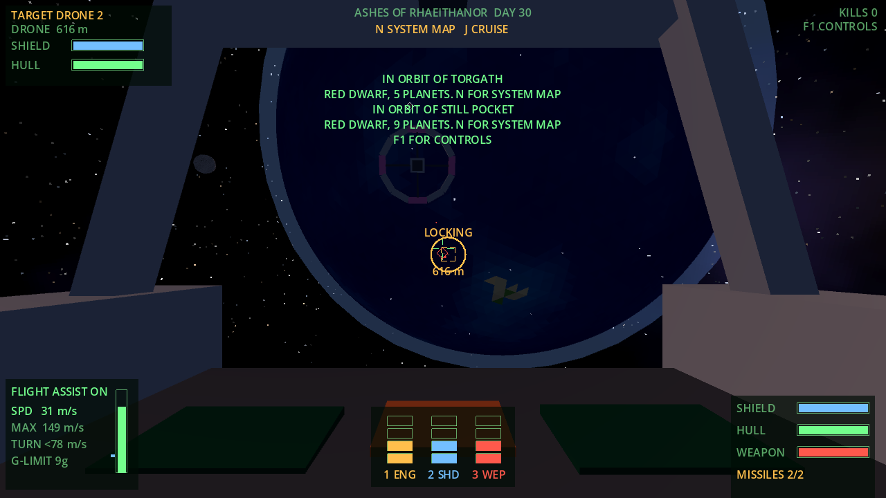

## Solar systems

Every system follows real astronomy. Its star has a real spectral class (mostly red and orange dwarfs, with yellow, white and the odd blue giant) with matching mass and brightness. Planets are spaced outwards and their type follows their temperature: molten worlds close in, Earth-like and ocean worlds in the habitable zone, gas and ice giants beyond the frost line, with moons and asteroid belts. Orbits follow Kepler's laws, so planets move round as the days pass. Settled worlds have names; the rest keep catalogue numbers.

You fly inside the real system. Planets are drawn at their true apparent size and grow as you approach, and the light comes from the actual star. There are three drives: the jump drive between systems, your thrusters for flying, and the autopilot (J) for crossing a system. The autopilot heads for your job or the station, or anywhere you pick on the system map (N): it turns you to it, builds to many times light speed once you're lined up, and drops you out a few kilometres short, facing it. Steer, or press J again, and you're flying. Long trips can be sped up to 20 times with the full stop key, and time drops back to normal by itself when you're in a fight, near a dock, low over the ground or arriving.

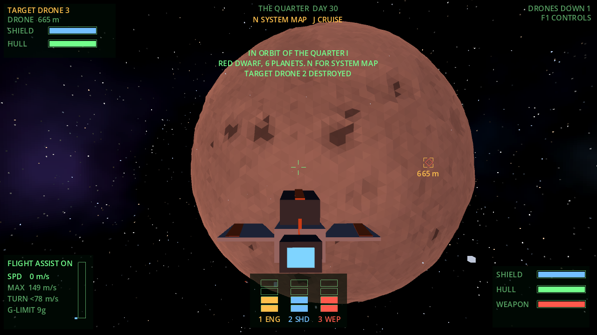

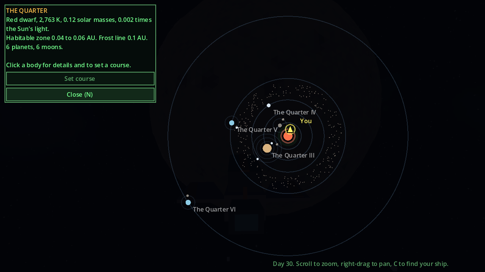

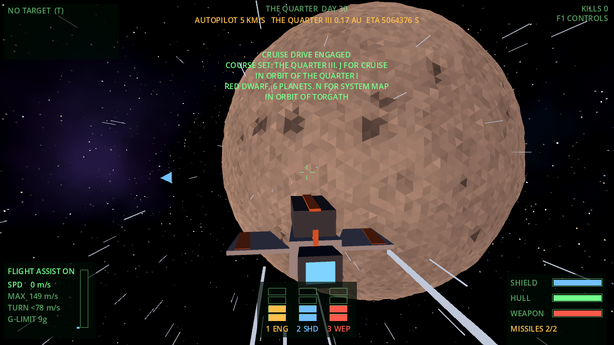

Rocky worlds have real ground: continents and seas, mountain chains, deserts with mesas and dunes, cratered moons, ice caps, lava seas. All of it comes from each world's seed whenever it's needed, so nothing is stored. The autopilot slows as you get lower and drops you out a few kilometres above the highest peaks, and from there you fly down under the world's real gravity. Some stations are surface ports on levelled ground (amber on the system map). Pick one on the system map as your destination and the autopilot drops you out above it, and you fly down, settle on the pad and press Enter to dock.

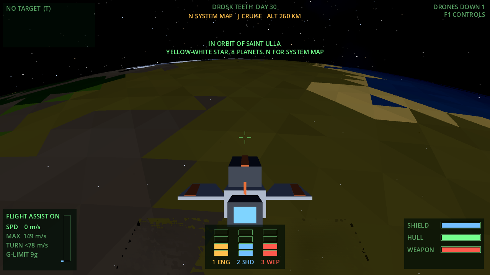

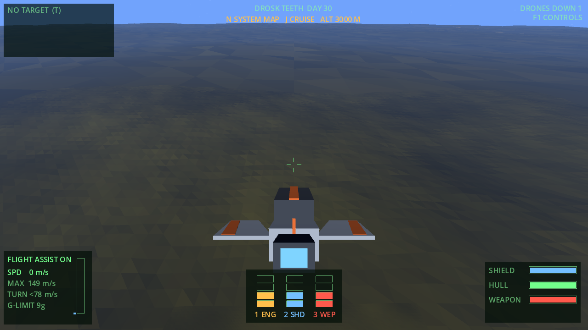

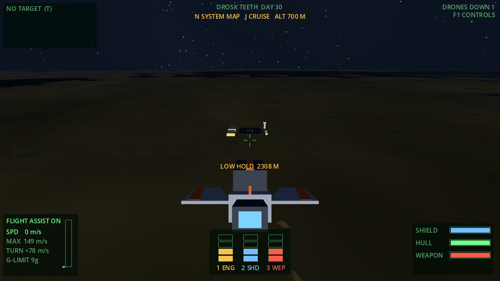

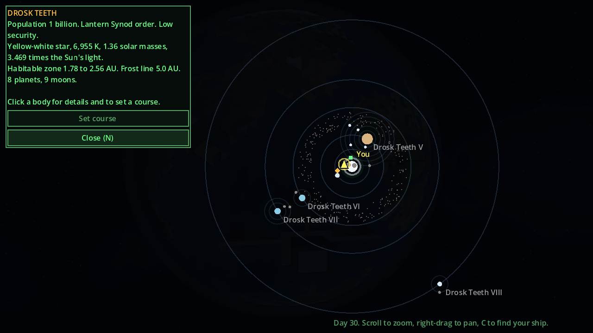

## A living galaxy

1,400 systems in four spiral arms, with nine great powers and about 160 smaller factions, criminals among them. Most of it starts empty. The galaxy runs day by day whether you're watching or not: factions survey and claim new systems, borders flare into disputes that can climb to war, and famines, mining rushes, plagues and stranger things at the rim break out and make the news.

Those 1,400 systems are the ones joined by jump gates. Between them lie about a billion more stars, generated from the galaxy seed when you look at them and following the same arms, core and rim. Zoom right in on the galaxy map and they appear, coloured by star type, with a ring showing your drive's reach. Any star inside the ring is a direct jump away. An explorer hull reaches 24 light years, a courier about 12 and a fighter barely 6, so getting far off the gate network needs the right ship. Each star you visit is added to your save; the rest are regenerated on demand.

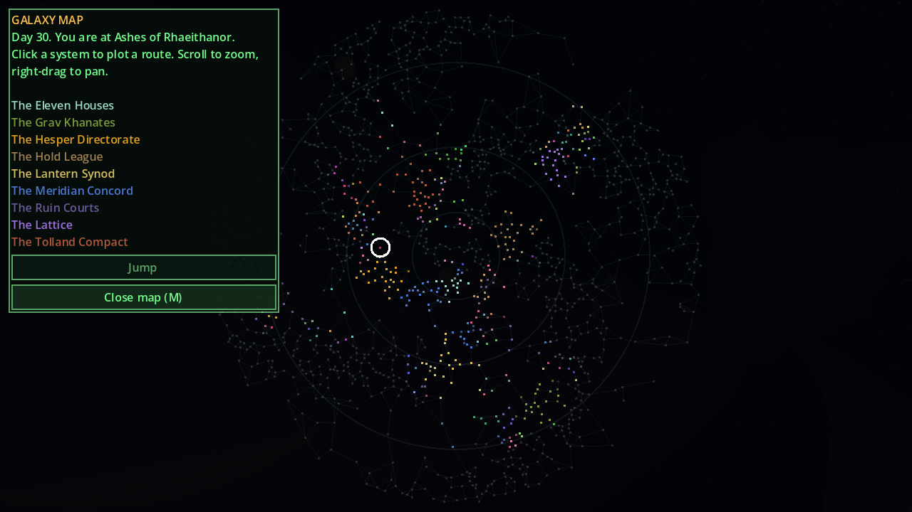

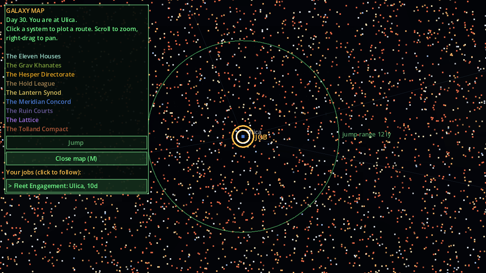

Travel is by the old elf gate network. Pick a destination and the map plots the route; days pass as you fly. Gates cost nothing; direct jumps to the stars between them use fuel, and tanks are generous (a courier's covers 150 light years, an explorer's 300), with a fill-up at any station and a rescue tug if you ever run dry. You jump from open space, clear of stations and planets, and arrive in open space too, then fly in. The map's Gates mode shows the main routes and the bridge gates, the only way into some parts of the galaxy; click any system to see its news, history and what you know of it, with a separate panel comparing its market with yours.

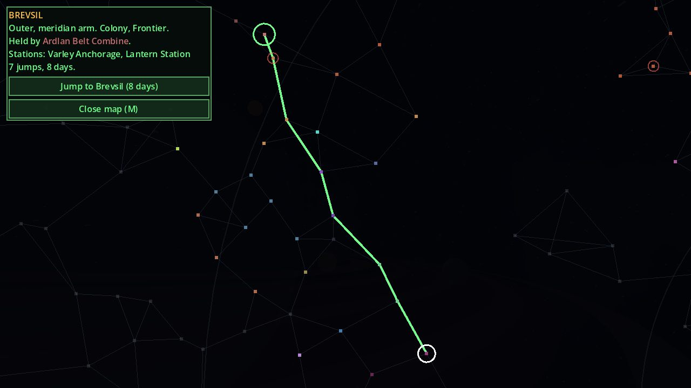

## Ways to start

New to it? Start with **Tutorial: First Flight**, a short campaign with an instructor that teaches flying, scanning, gunnery, matching speed, the galaxy map and a first fight, then lets you loose. Want a taste of the big fights? **Battle preview** drops you straight into any set piece in a good ship; when it's over you can fly it again or go back to the menu (F3 shows the frame rate and ship count, which makes it a handy test bench).

Start as a free trader with a small ship and the whole galaxy, or enlist in a campaign. A campaign puts you in a great power's service, in their ship, with a base to return to: a flagship parked with its fleet. Dock with it for your orders, fly the mission, and come back for a debrief and the next. Missions build from reconnaissance (fly close to beacons and pickets and hold while you scan), refuelling a stranded ship while pirates close in, escorts and intercepts, up to a full battle at the end. The same galaxy carries on around you, and when the campaign is over you're free.

- **The Concord Watch:** the Meridian Concord against the Grav Khanates, flying from the battlecruiser Sovereign Clause.
- **The Iron Tithe:** the Grav Khanates against the Hold League, from the Skullfang.
- **The Long Road:** the Tolland Compact on the frontier, against pirates and the Unbound, from the Hard Reckoning.

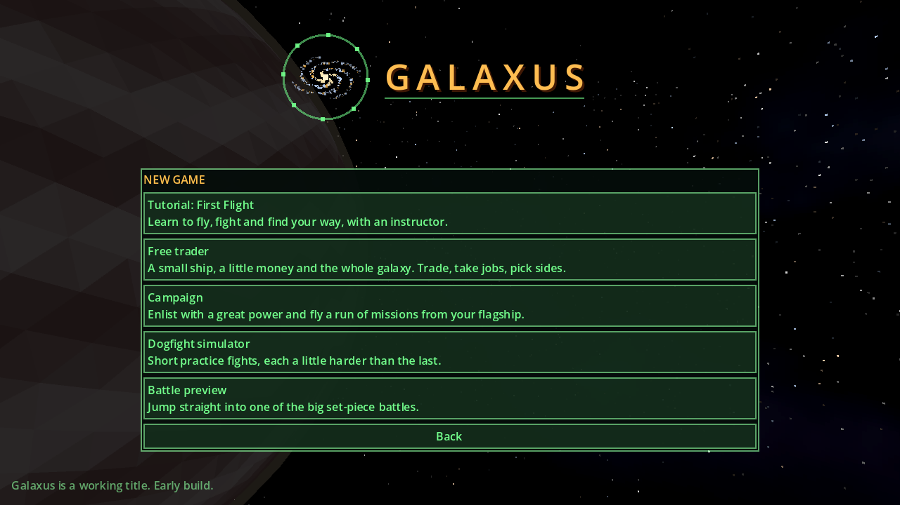

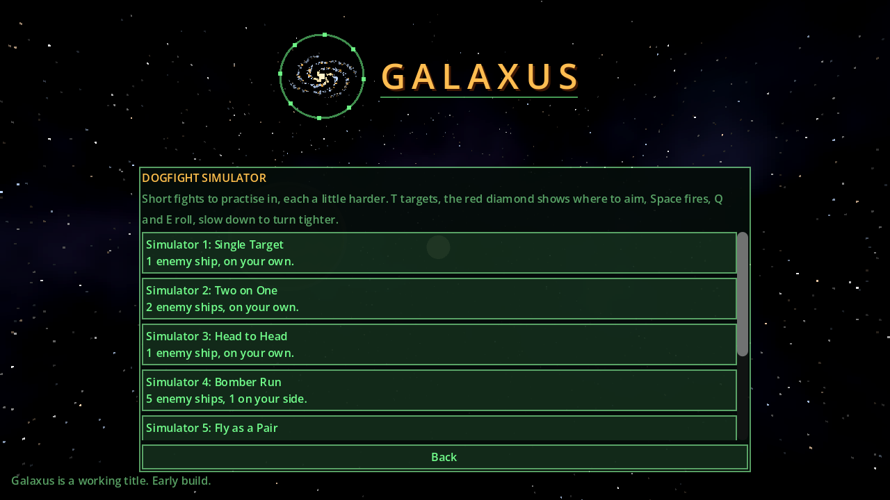

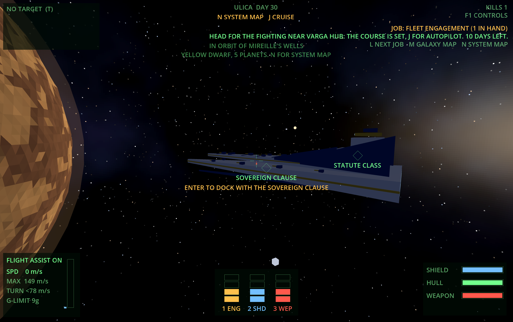

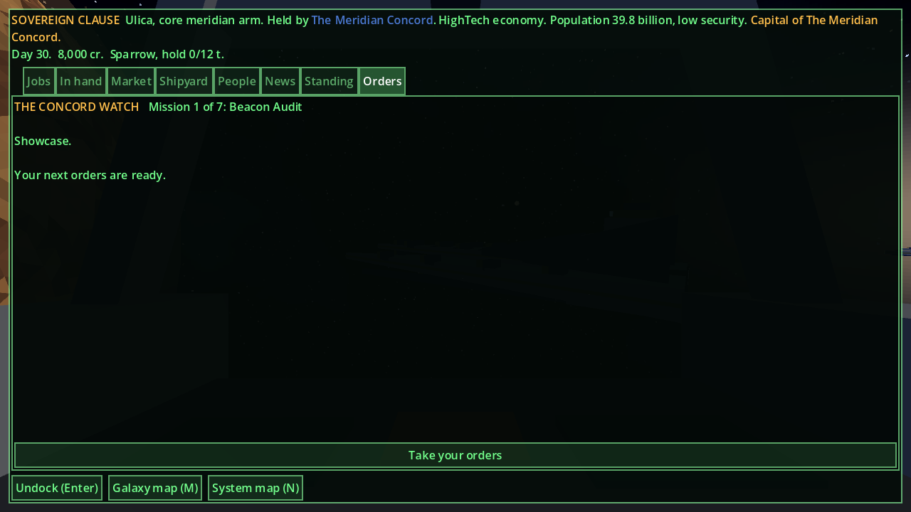

## Battles and warships

What you do changes the galaxy. Each war battle you fight pushes that war one way or the other: win enough and the front system falls to your side, and a run of defeats makes the losing side sue for peace. Hunting pirates drives them out of their haunts. Every turn makes the news at the front and in both sides' capitals, so you'll hear about it at stations across that part of the galaxy. Ordinary combat jobs (bounties, escorts, patrols, raids, claim-jumpers, guarding miners) are played out as battles too.

The wars between factions are fought in set pieces, in the spirit of X-Wing and TIE Fighter. Factions at war post battles on job boards near their front lines; lawful factions post pirate hunts, the outer galaxy has rogue machines, and stations near trouble ask for defenders. Take one, fly to the system and head for the fighting, and the battle comes to you in waves: fighter screens, bomber runs on the warships, carriers launching their wings, cruisers jumping in, convoys trying to get clear. Command talks to you over the radio, the objectives sit on the HUD, and the job pays when you win, with a bonus for the optional objectives.

Every great power has a navy of its own design: frigates, cruisers, Star Destroyer sized battlecruisers and carriers, with turrets that pick their own targets. Pirates fly salvaged warships, and the Unbound, machines that broke from the Lattice, fly things that look grown rather than built. Weapons come in kinds that look and behave differently: lasers, pulse guns, beams, plasma, rail slugs, scatter guns, flak that bursts among fighters, homing missiles and slow, heavy torpedoes. Battles are data in `game/data/battles`, so they can be added by mods.

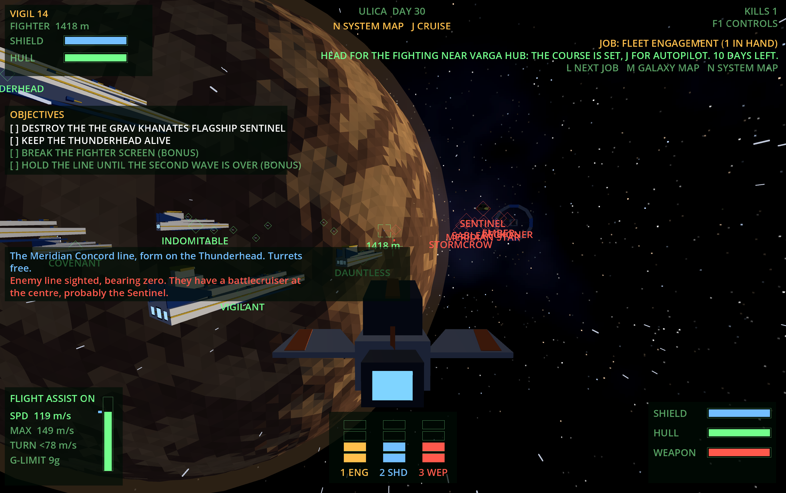

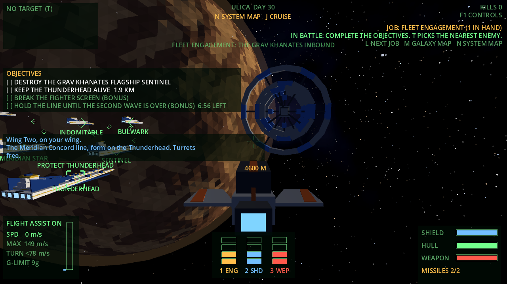

The HUD keeps you oriented: the ship each objective is about is bracketed and labelled (protect, destroy, scan, escort, match speed), with arrows at the screen edge when it's behind you, distances and time left on the objectives list, and a line saying who is shooting at you and what to do about it.

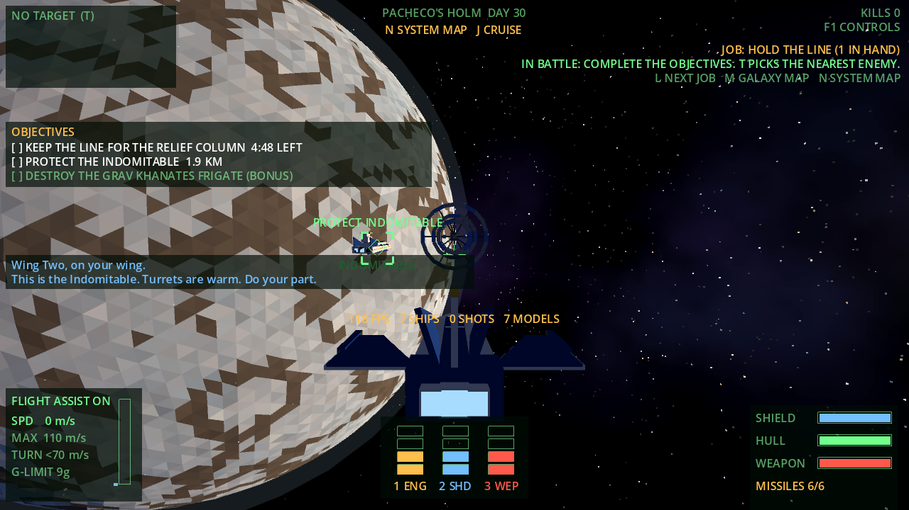

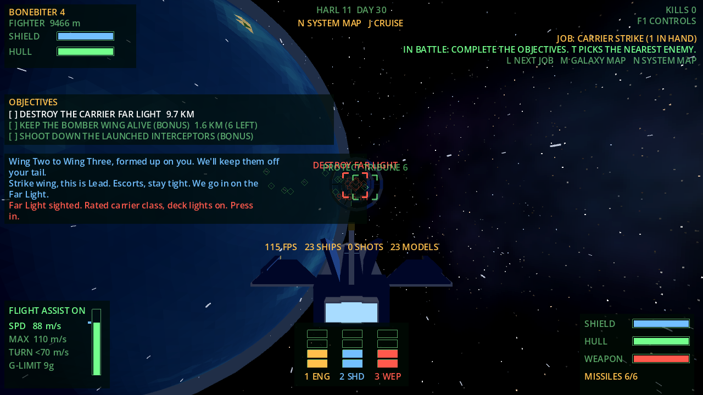

## Traffic, stations and systems

Systems are busy in proportion to who lives there. Traders come and go at the station, patrols fly the space around it, and where the law is thin pirates go for traders and for you; the local owner pays a bounty for each one you bring down. Fire on a trader and the police come for you. Every system has a population, a government and a security level, shown on both maps and at the station. Stations grow with the population they serve, from small outposts to great hubs and citadels, and each power and people builds its own kind: the Concord's rings, the Tolland Compact's claw spires, the Lantern Synod's pyramids, the Directorate's spindles and battle-sphere capitals, the Eleven Houses' crowns of spires, dwarf and pirate asteroid bases, free machine lattices and the dark elves' broken rings. Mods can name a design or bring their own model.

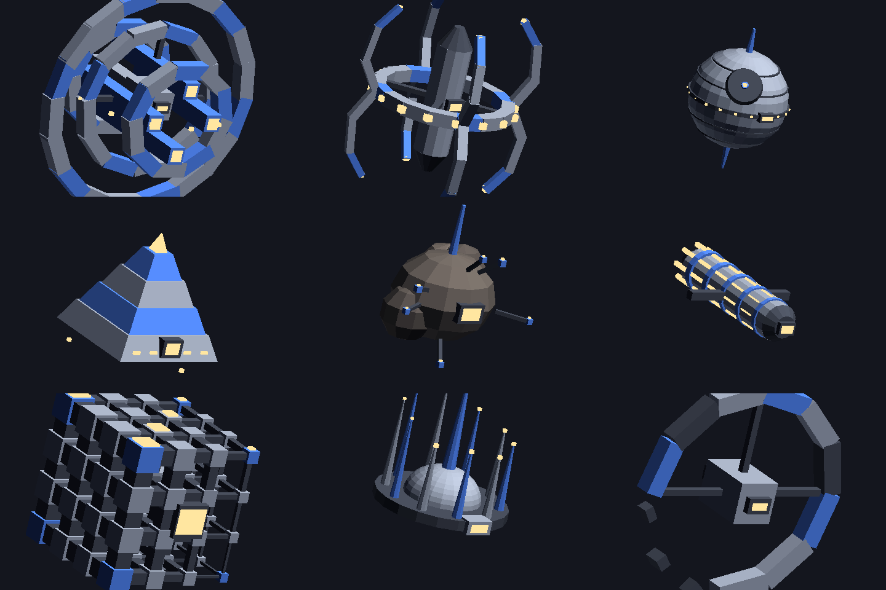

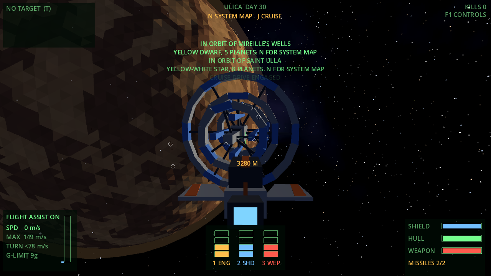

## Stations and talking to people

There's no walking about. Everything happens from the cockpit and the station screens. Jobs come out of what's happening locally (a famine makes relief runs, a war makes escort and blockade work), and every client writes their contract in their own race's voice.

An orc khanate wants wine for a feast:

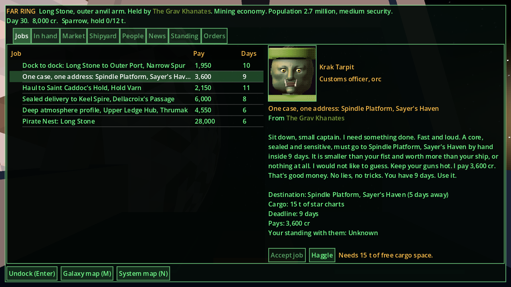

> My name is Ghush Thundergut and I've never lost a fight I wanted. It's easy for me, but I'm busy. … I'm richer than I look. You have 10 days. Use it. Don't dawdle.

A light elf house wants atmosphere readings, and would like you to know it's doing you a favour:

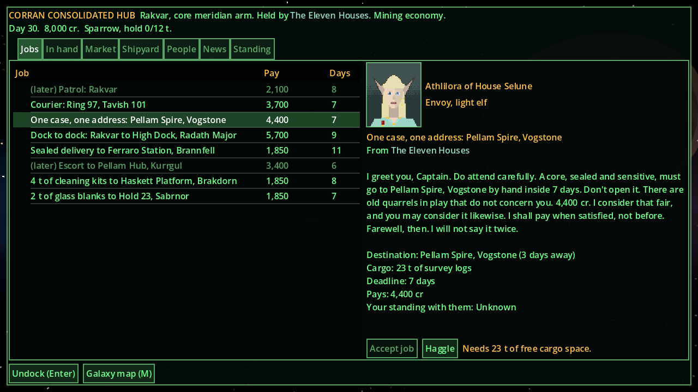

> This is a commission, not a favour, though you may feel otherwise. I require something done properly, which is rare. … The fee is 4,650 cr. I do not bargain.

A dwarf guild needs a rescue, a free machine collective needs a sealed delivery, and a dark elf archive needs something carried and not opened:

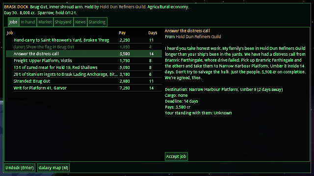

> I heard you take honest work. My family's been in Hold Dun Refiners Guild longer than your ship's been in the yards. … Just the people. 3,500 cr on completion. We're agreed, then.

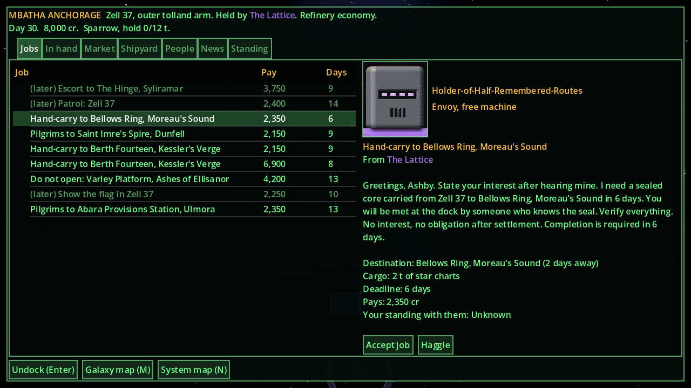

> I observe you. This is a transaction, not a favour. … Good performance is stored. The ledger balances only if the interval holds.

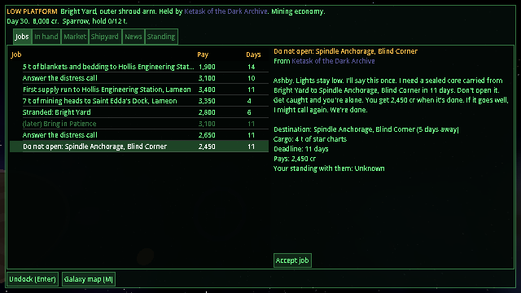

> Ashby. Lights stay low. I'll say this once. … Get caught and you're alone. … If it goes well, I might call again. We're done.

Crew you hire will have the same voices. Their chatter is already written for every race, ready for the crew system:

> **Dwarf:** Rumour says a survey tug past the last good gate stopped answering hails. I'd like to see their maintenance log.
>
> **Synth:** Captain. You're the first person to make eye contact today. I notice things. It's not unfriendly, it's habit.
>
> **Free machine:** I decline to continue. You did not listen, and I have a long memory. The ledger is closed. The memory is not.

Every contract shows the client's face, and you can haggle over the pay. Dwarves enjoy a haggle, light elves take offence, orcs respect the nerve even when they say no, and free machines call it a renegotiation and never mind. Push the wrong client and the job is withdrawn.

## People

Stations are full of people, and they're the same people when you come back. Each station has regulars who are always there (a bartender, someone running the docks, a few locals) and visitors drawn from a fixed pool for that place, so you'll run into them again. Each faction has a few named contacts who post its work, so you keep dealing with the same orc boss or elf steward, and the game remembers who you've met.

You can talk to anyone: ask for news, ask about work, ask about them, or buy them a drink. They answer in their race's voice, and what they tell you is true: events, wars and prices in nearby systems, and good work going. Each person remembers how you've treated them. Drinks and good manners warm them up, pestering cools them, and someone cold won't tell you anything. Win enough trust, especially from a smuggler or broker, and they'll tell you where a criminal faction can be found. That lead goes on your galaxy map, which is how you find your way into the underworld.

Faces are 16-bit style pixel art, built from a pool of features for each race: skin, hair and eye colours, ears, head and jaw shapes, hairstyles, beards, tusks, scars, freckles, tattoos, earrings, eyepatches, cybernetics and synth seams, shaped for women and men. Free machines have chassis heads with visors and antennae. What people do shows in what they wear: miners have hard hats with lamps and hi-vis straps, customs officers wear caps and epaulettes, mercenaries wear armour, pilots wear headsets.

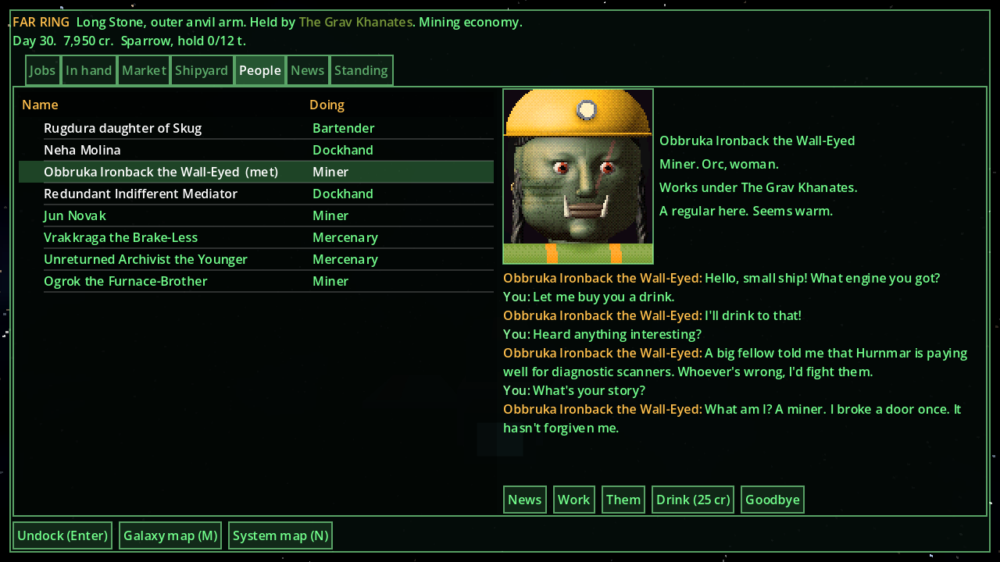

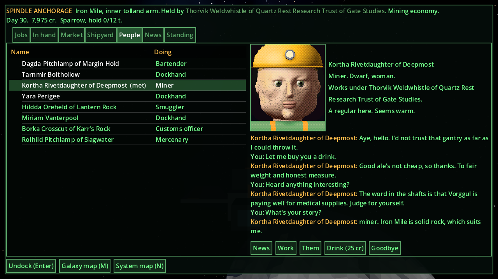

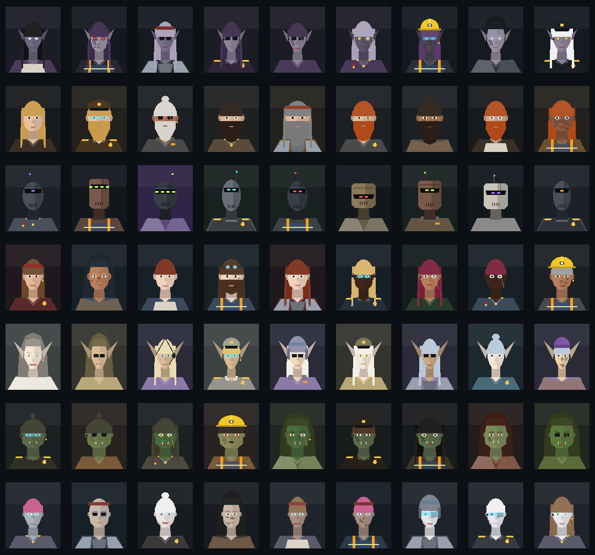

Stations also have a market for 128 kinds of goods, a shipyard, an outfitter, local news and your standing with each faction. At the outfitter you pick one of your ship's slots and see every part on sale that fits it, with what it would change (speed, shields, firepower, hold, fuel) before you buy; the old part is sold back for half its list price. Stock changes weekly and bigger stations carry higher marks. Utility gear works in flight: armour, repair rigs that patch the hull once your shields are up, fuel scoops for skimming a star (pick the star on the system map), drop tanks, missile decoys, stealth veils, hidden holds, afterburners (H) and more. Small mining lasers fit a gun mount, so even the starter ship can mine.

## The law, hailing and the underworld

Crime is held against the faction whose space you commit it in, and it follows you anywhere that faction rules. Firing on a lawful ship, destroying one, getting caught with contraband, running from a stop and refusing to pay all go on your record, each with a fine. Small offences leave you fined; serious ones make you wanted, and clearing that costs half as much again. Pay at any of that faction's stations from the Standing tab, or to a patrol in flight. Criminal factions keep no records.

Enter a system whose police you owe and a patrol comes out to hail you: pay, promise to pay at the next station, or refuse and be hunted. Stations turn the wanted away until they pay. Customs scan your hold now and then as you dock, and patrols sometimes stop you for a scan, more often where security is high. Contraband in the open is almost always found, seized and fined, and a smuggling job loses its cargo with it; a hidden hold makes it far harder to find.

Hails come up at the top of the screen with the caller's face and their ship turning in a little window, and your replies as buttons. Pirates hail before they attack: dump your cargo, pay them off, or fight. Press Y to hail a ship you've targeted. The system map now shows the ships about the system (traders on their runs, patrols, miners at the belt, and in poorly policed systems pirates and fences), and you can hail any of them from there or fly out to meet them. Fences buy and sell contraband and tell you which local gang is hiring. Illegal jobs stay off a station's board until someone has told you who to ask: a fence, or gossip in the bar.

## Crew and wingmen

Some of the people in station bars will work for you: pick them on the People tab and the Hire button shows their terms, a fee up front and a daily wage. Pilots and mercenaries fly as wingmen in their own fighters, up to two, in ordinary flight and in battles, and keep up on the autopilot. F5 sends them after your target, F6 has them defend you, F7 forms them up off your wing. They get better with every kill, and a wingman shot down may not get out; the lucky ones are back when you next dock. Engineers, gunners and navigators take a berth aboard (your hull says how many) and help a little: shields recharge faster, guns hit harder, jumps reach further on less fuel. Wages are paid when you dock, and anyone you can't pay leaves. The Crew tab shows who you have and what they cost.

## The logbook, lore and treasure hunts

O opens the logbook anywhere, including on the autopilot, which keeps flying while you read. It has three parts. The news, newest first, filtered to everything, within four jumps, where your jobs are, or unread, with each system linked to the galaxy map. Lore: histories, legends and the ways of each people, which people in station bars tell you once they like you, each in their own voice. And clues and finds: your treasure hunts, leads and everything your scanner has turned up. The HUD says when something new goes in.

Treasure hunts come in three pieces, from gossip and now and then from a scan: the first names a region and arm, the second a system, the third a body. With all three the galaxy map marks it and scanning the body finds what's there, which may or may not be what the legend promised. Lore entries are content in `game/data/lore` and hunts in `game/data/clues`, so mods can add their own.

## Mining, scanning and finds

Belts are places now. Pick one on the system map and the autopilot takes you to a clump of rocks; each rock's ore and size come from the belt's seed, so the same rocks are always there. Warm belts are stony and metallic, cold ones icy, and a few rocks anywhere carry rare metals. Target a rock with T, scan it with K to see its ore and how much is left, and hold fire with a mining laser fitted to cut it into your hold. Rocks shrink as you work them.

The scanner works on more than rocks. Scan a ship for its cargo, and a planet, moon or the star for survey data, which any station buys from the new Logbook tab; it pays more for rarer stars and for systems off the gates. Anything can carry a find: a lost survey drone, a Dominion toll beacon, a wreck from the Walkout, a Horde marker, a smuggler's stash or a rich seam. Some finds are leads to a cache a few gates away, written in the logbook until you go and scan the body they name. Finds are content in `game/data/finds`, so mods can add their own.

Survey jobs now need the scan done before you dock, and mining jobs in systems with a belt need the ore cut and brought in. Mining jobs where there's no belt are still about guarding someone else's miners.

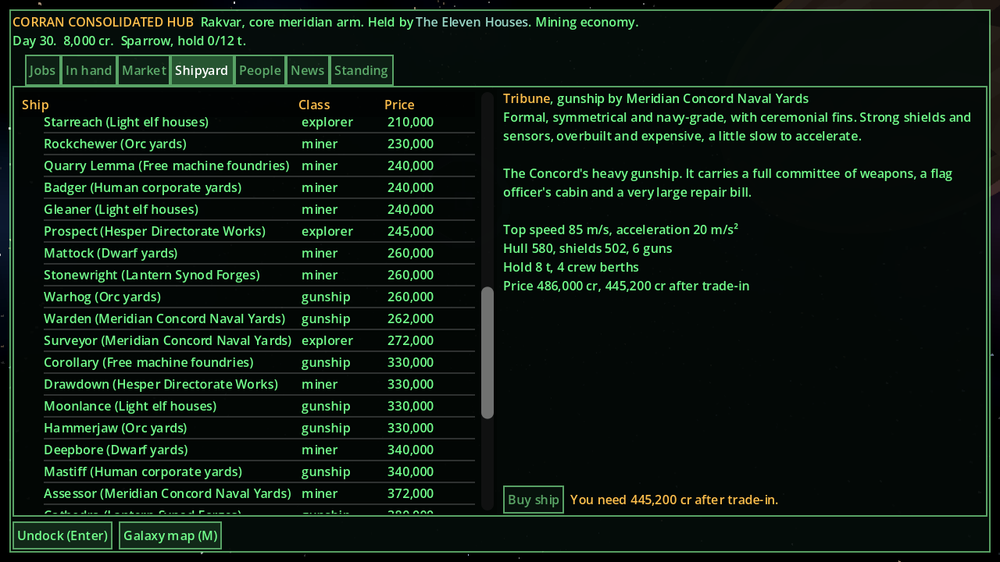

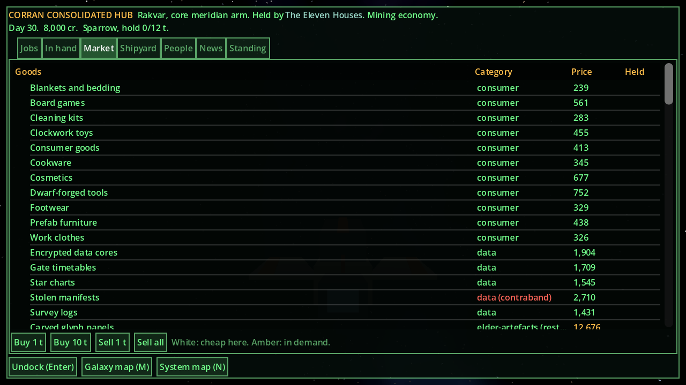

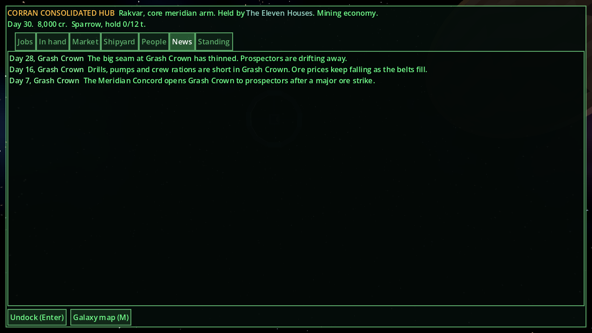

## Ships

88 ships from 11 builders, each with its own look: Concord navy white and blue, sleek Directorate black and gold, rugged Tolland frontier rust, Synod cathedral spires, slender light elf blades, chunky dwarf slabs, orc ships that are mostly engine, asymmetric free machine lattices, re-forged dark elf hulls from the rim, and the Breakers' Guild's patchwork salvage. Ships are built from data as flat-shaded shapes, so a new ship needs no art files.

Warships come on top of that: every great power has a frigate, cruiser, battlecruiser and carrier of its own design, pirates fly salvaged warships, and the Unbound fly grown ones.

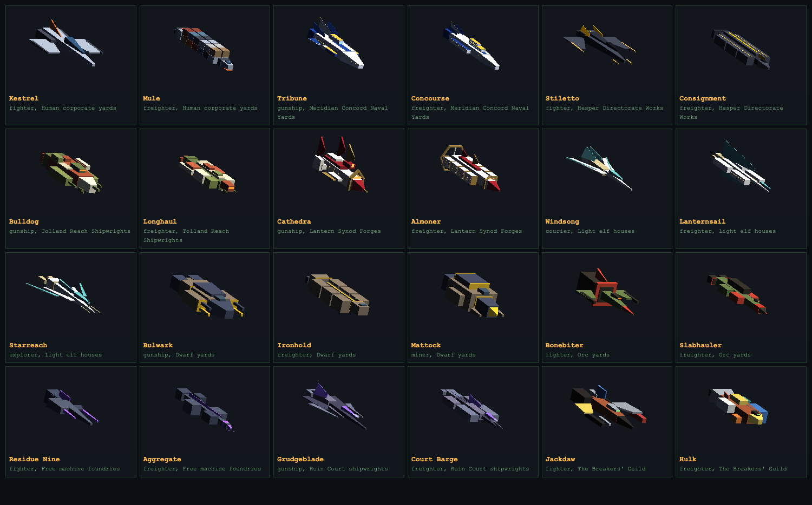

The **Ships and stations** viewer, on the main menu, shows every ship, warship and station: turn it, zoom in, read its numbers, and put a fighter alongside a warship for scale. There's also a separate **Galaxus Preview** build that opens straight into it (see [docs/building.md](docs/building.md)).

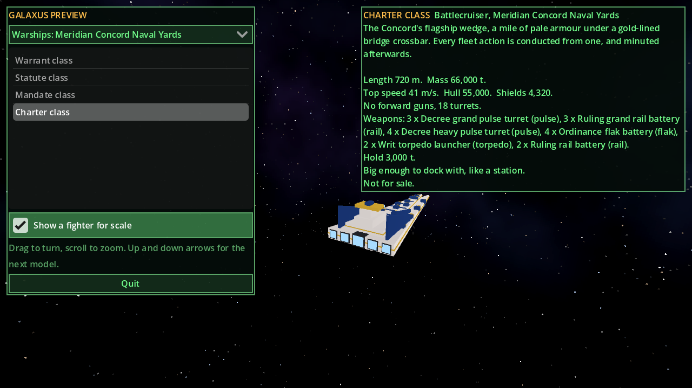

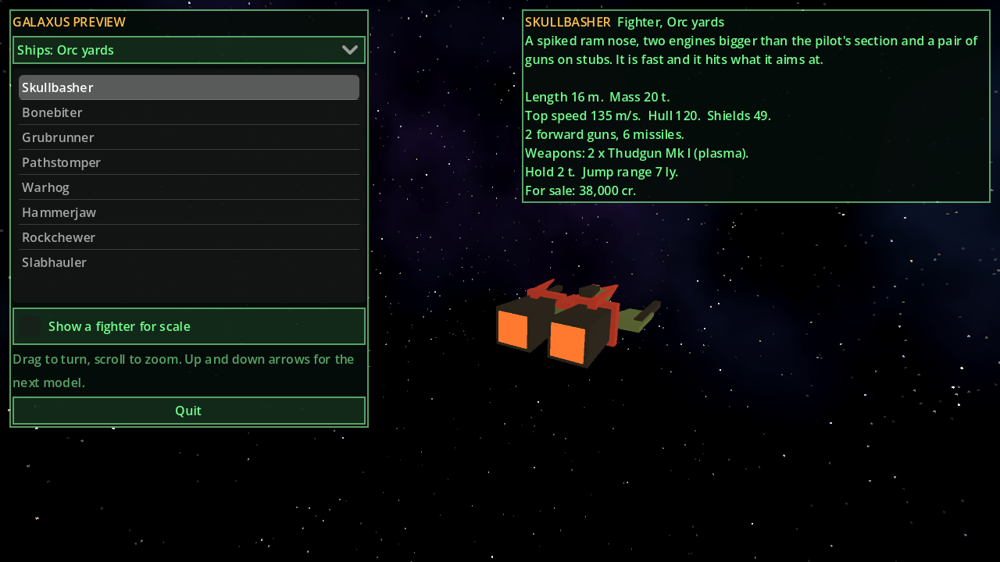

## Sound

All sound and music is synthesised in code. The music is 8-channel chiptune composed in a style for each race: a steady working-port tune in human space, slow drifting arpeggios at light elf courts, a dwarf march with an anvil, fast and loud orc khanates. Engines and guns sound different by builder, and stations clank and hum according to what they do.

## Runs on

The aim is to run on as many computers as possible.

- **Graphics:** Godot's Compatibility renderer (OpenGL 3.3) with flat-shaded low-poly models and light anti-aliasing. It's meant for integrated graphics and old laptops. Screens are laid out on a 640x360 grid and drawn at the window's full resolution, so text stays sharp at any size.
- **.NET:** players don't need it. Exported builds carry their own copy of the .NET runtime, which adds a few tens of MB to the download.
- **Operating systems:** Windows 10 and later, recent macOS, and 64-bit Linux including the Steam Deck. Windows 7 and 8 aren't supported by current .NET.
- **Browser:** Godot can't export C# games to the web, so there's no browser version. The brief is PC only.
- **Minimum spec:** not tested yet. That needs real exported builds tried on old machines.

## Running it

To develop, you need the .NET SDK (the project targets .NET 10) and Godot 4.7 .NET edition.

```
tools/play.sh            # build and run
tools/validate.sh        # check all content and run the tests
```

To make standalone builds for Mac, Windows and Linux, see [docs/building.md](docs/building.md).

On a Mac, `tools/make-launcher.sh` makes `~/Applications/Galaxus.app` with the Galaxus name and icon. It builds the latest code and runs the game, so you can keep it in the Dock. Logs go to `~/Library/Logs/Galaxus.log`.

`tools/godot.sh` looks for Godot at `~/Applications/Godot_mono.app`. Set `GODOT` to point elsewhere. To open the project in the editor, run `tools/godot.sh -e`.

Debug options go after `--`. For example, `tools/play.sh -- --demo` flies and shoots by itself, and `tools/godot.sh -- --showcase=docs/screenshots` replays the tour that took the screenshots above. See the top of `game/src/Main.cs` for the full list.

## Controls

There's a printable sheet in [docs/controls.pdf](docs/controls.pdf), and F1 shows the list in game. Every control can be rebound in Settings, Controls, separately for keyboard and mouse and for controllers. Xbox and PlayStation pads work out of the box on Mac and Windows; flight sticks and HOTAS set up the same way, including a throttle lever that sets your throttle where it sits.

| Action | Keyboard and mouse | Gamepad |
| --- | --- | --- |
| Pitch and yaw | Mouse (virtual stick), arrow keys; Down raises the nose | Left stick |
| Yaw | A, D | |
| Roll | Q, E | Bumpers, right stick X |
| Throttle (assist on) or thrust (assist off) | W, S | Right stick Y |
| Zero throttle | X | Right stick click |
| Thrusters up, down, left, right | R, F, Z, C | |
| Fire | Space, left click | Right trigger |
| Fire a missile (once locked) | B, right click | Left trigger |
| Afterburner (if fitted) | H | |
| Scan your target or the world you're near | K | |
| Hail your target | Y | |
| Logbook: news, lore, clues and finds | O | |
| Wing: attack my target, defend me, form up | F5, F6, F7 | |
| Flight assist on or off | G | B |
| Power to engines, shields, weapons | 1, 2, 3 | D-pad up, left, right |
| Balance power | 4 | D-pad down |
| Next target (ships, then asteroids) | T | A |
| Chase or cockpit camera | V | Y |
| Dock (when close and slow) and undock | Enter | X |
| Galaxy map | M | Start |
| System map: pick a destination | N | View / Share |
| System map: find your ship | C | |
| Autopilot to your destination | J | Left stick click |
| Speed time up, slow it down | Full stop, comma | |
| Follow your next job | L | |
| Match target speed | Tab | |
| Pause menu: save, load, settings (difficulty is in Settings) | Esc | |
| Controls on screen | F1 | |
| Frame rate and ship count | F3 | |
| Quit | F10 | |

Cruise, the system map, time and job switching have no controller buttons yet ([issue 6](https://github.com/DominicFinn/galaxus/issues/6)).

## Lore

The setting is in [docs/lore-bible.md](docs/lore-bible.md), with deeper histories in [docs/lore](docs/lore): the elves, who will never say where they came from; the orcs, their Goddess and an empire that never was; and humanity's long run of empires, leagues and rebellions, starting from a single home world that may only be a rumour. The people you talk to at stations repeat what they've heard of it.

## Expanding the universe

Anyone can add factions, missions, events and flavour text by dropping a mod folder into `mods/`, with no code needed. [docs/expanding-the-universe.md](docs/expanding-the-universe.md) explains how, including a prompt to hand to Claude Code. `tools/validate-mods.sh` checks a mod, and `mods/example-free-traders` is a small working example.

## Layout

```
core/Galaxus.Core/   Plain C# game logic: flight, ships, combat, the galaxy simulation, missions,
                     saves, text grammars and the audio synthesiser. No Godot dependency, so it's
                     testable and runs headless.
game/                Godot project. Rendering, input, screens and audio playback.
mods/                Optional content added on top of the base game. One folder per mod.
game/data/           All content as JSON: races, factions, ships, parts, goods, events, missions,
                     names, voices and music styles. See docs/content-guide.md and docs/lore-bible.md.
tests/               xUnit tests for the core, including tests that load and generate every piece of content.
tools/               Scripts for running, validating (content and mods), previewing ship models and making the Mac launcher.
docs/                Lore bible, content guide, control sheet, branding and screenshots.
```
