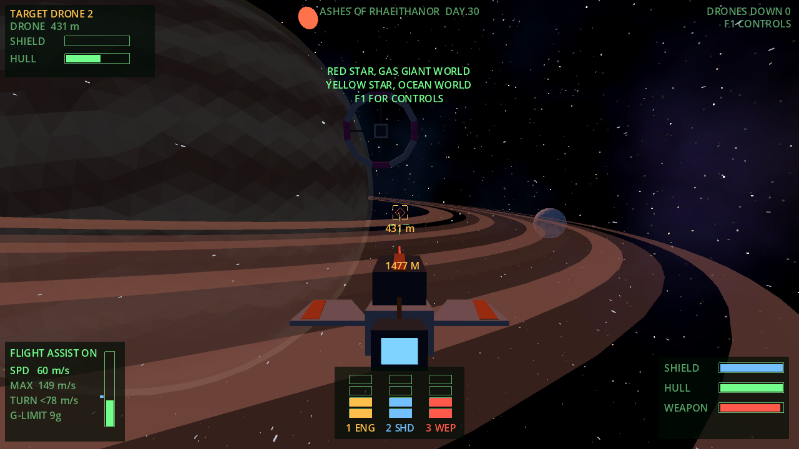

# Galaxus

Galaxus (a working title) is a space game for PC in the spirit of Frontier: Elite II, with X-Wing style flight. You're an independent captain who trades, takes jobs and picks sides in a galaxy that keeps running without you. The design brief is in [docs/design-brief.md](docs/design-brief.md).

It's built to run on almost any computer: flat-shaded low-poly models and Godot's simplest renderer, with every ship, planet, name, mission and piece of music generated from data rather than drawn or recorded.


## Flying

Flight assist holds your speed and keeps you travelling where the nose points; switch it off and the drives just push. Your pilot's g-tolerance limits how hard you can turn at speed, so you turn tightest at lower throttle. Six power pips are shared between engines, shields and weapons.

Every system has its own star and main world: gas giants with rings, airless cratered moons, ice, lava, desert, ocean and toxic worlds.




## Solar systems

Every system follows real astronomy. Its star has a real spectral class (mostly red and orange dwarfs, with yellow, white and the odd blue giant) with matching mass and brightness. Planets are spaced outwards and their type follows their temperature: molten worlds close in, Earth-like and ocean worlds in the habitable zone, gas and ice giants beyond the frost line, with moons and asteroid belts. Orbits follow Kepler's laws, so planets move round as the days pass. Settled worlds have names; the rest keep catalogue numbers.

You fly inside the real system. Planets are drawn at their true apparent size and grow as you approach, and the light comes from the actual star. Set a course on the system map (N) and engage the cruise drive (J). With a course set it flies itself: it turns you to the target, builds to many times light speed once you're lined up, and drops you out beside your destination. Take the stick and you're flying again until you let go. Long trips can be sped up to 20 times with the full stop key, and time drops back to normal by itself when you're in a fight, near a dock, low over the ground or arriving.


Rocky worlds have real ground: continents and seas, mountain chains, deserts with mesas and dunes, cratered moons, ice caps, lava seas. All of it comes from each world's seed whenever it's needed, so nothing is stored. Cruise slows as you get lower and drops you out a few kilometres above the highest peaks, and from there you fly down under the world's real gravity. Some stations are surface ports on levelled ground (amber on the system map). Pick one on the system map and set a course: cruise drops you out above it, and you fly down, settle on the pad and press Enter to dock.


## A living galaxy

1,400 systems in four spiral arms, with nine great powers and about 160 smaller factions, criminals among them. Most of it starts empty. The galaxy runs day by day whether you're watching or not: factions survey and claim new systems, borders flare into disputes that can climb to war, and famines, mining rushes, plagues and stranger things at the rim break out and make the news.

Those 1,400 systems are the ones joined by jump gates. Between them lie about a billion more stars, generated from the galaxy seed when you look at them and following the same arms, core and rim. Zoom right in on the galaxy map and they appear, coloured by star type, with a ring showing your drive's reach. Any star inside the ring is a direct jump away. An explorer hull reaches 24 light years, a courier about 12 and a fighter barely 6, so getting far off the gate network needs the right ship. Each star you visit is added to your save; the rest are regenerated on demand.


Travel is by the old elf gate network. Pick a destination and the map plots the route; days pass as you fly.


## Battles and warships

The wars between factions are fought in set pieces, in the spirit of X-Wing and TIE Fighter. Factions at war post battles on job boards near their front lines; lawful factions post pirate hunts, the outer galaxy has rogue machines, and stations near trouble ask for defenders. Take one, fly to the system and head for the fighting, and the battle comes to you in waves: fighter screens, bomber runs on the warships, carriers launching their wings, cruisers jumping in, convoys trying to get clear. Command talks to you over the radio, the objectives sit on the HUD, and the job pays when you win, with a bonus for the optional objectives.

Every great power has a navy of its own design: frigates, cruisers, Star Destroyer sized battlecruisers and carriers, with turrets that pick their own targets. Pirates fly salvaged warships, and the Unbound, machines that broke from the Lattice, fly things that look grown rather than built. Weapons come in kinds that look and behave differently: lasers, pulse guns, beams, plasma, rail slugs, scatter guns, flak that bursts among fighters, homing missiles and slow, heavy torpedoes. Battles are data in `game/data/battles`, so they can be added by mods.


## Stations and talking to people

There's no walking about. Everything happens from the cockpit and the station screens. Jobs come out of what's happening locally (a famine makes relief runs, a war makes escort and blockade work), and every client writes their contract in their own race's voice.

An orc khanate wants wine for a feast:


> My name is Ghush Thundergut and I've never lost a fight I wanted. It's easy for me, but I'm busy. … I'm richer than I look. You have 10 days. Use it. Don't dawdle.

A light elf house wants atmosphere readings, and would like you to know it's doing you a favour:


> This is a commission, not a favour, though you may feel otherwise. I require something done properly, which is rare. … The fee is 4,650 cr. I do not bargain.

A dwarf guild needs a rescue, a free machine collective needs a sealed delivery, and a dark elf archive needs something carried and not opened:


> I heard you take honest work. My family's been in Hold Dun Refiners Guild longer than your ship's been in the yards. … Just the people. 3,500 cr on completion. We're agreed, then.


> I observe you. This is a transaction, not a favour. … Good performance is stored. The ledger balances only if the interval holds.


> Ashby. Lights stay low. I'll say this once. … Get caught and you're alone. … If it goes well, I might call again. We're done.

Crew you hire will have the same voices. Their chatter is already written for every race, ready for the crew system:

> **Dwarf:** Rumour says a survey tug past the last good gate stopped answering hails. I'd like to see their maintenance log.
>
> **Synth:** Captain. You're the first person to make eye contact today. I notice things. It's not unfriendly, it's habit.
>
> **Free machine:** I decline to continue. You did not listen, and I have a long memory. The ledger is closed. The memory is not.

Every contract shows the client's face, and you can haggle over the pay. Dwarves enjoy a haggle, light elves take offence, orcs respect the nerve even when they say no, and free machines call it a renegotiation and never mind. Push the wrong client and the job is withdrawn.

## People

Stations are full of people, and they're the same people when you come back. Each station has regulars who are always there (a bartender, someone running the docks, a few locals) and visitors drawn from a fixed pool for that place, so you'll run into them again. Each faction has a few named contacts who post its work, so you keep dealing with the same orc boss or elf steward, and the game remembers who you've met.

You can talk to anyone: ask for news, ask about work, ask about them, or buy them a drink. They answer in their race's voice, and what they tell you is true: events, wars and prices in nearby systems, and good work going. Each person remembers how you've treated them. Drinks and good manners warm them up, pestering cools them, and someone cold won't tell you anything. Win enough trust, especially from a smuggler or broker, and they'll tell you where a criminal faction can be found. That lead goes on your galaxy map, which is how you find your way into the underworld.

Faces are 16-bit style pixel art, built from a pool of features for each race: skin, hair and eye colours, ears, head and jaw shapes, hairstyles, beards, tusks, scars, freckles, tattoos, earrings, eyepatches, cybernetics and synth seams, shaped for women and men. Free machines have chassis heads with visors and antennae. What people do shows in what they wear: miners have hard hats with lamps and hi-vis straps, customs officers wear caps and epaulettes, mercenaries wear armour, pilots wear headsets.


Stations also have a market for 128 kinds of goods, a shipyard, local news and your standing with each faction.


## Ships

88 ships from 11 builders, each with its own look: Concord navy white and blue, sleek Directorate black and gold, rugged Tolland frontier rust, Synod cathedral spires, slender light elf blades, chunky dwarf slabs, orc ships that are mostly engine, asymmetric free machine lattices, re-forged dark elf hulls from the rim, and the Breakers' Guild's patchwork salvage. Ships are built from data as flat-shaded shapes, so a new ship needs no art files.


## Sound

All sound and music is synthesised in code. The music is 8-channel chiptune composed in a style for each race: a steady working-port tune in human space, slow drifting arpeggios at light elf courts, a dwarf march with an anvil, fast and loud orc khanates. Engines and guns sound different by builder, and stations clank and hum according to what they do.

## Runs on

The aim is to run on as many computers as possible.

- **Graphics:** Godot's Compatibility renderer (OpenGL 3.3) with flat-shaded low-poly models and light anti-aliasing. It's meant for integrated graphics and old laptops. Screens are laid out on a 640x360 grid and drawn at the window's full resolution, so text stays sharp at any size.
- **.NET:** players don't need it. Exported builds carry their own copy of the .NET runtime, which adds a few tens of MB to the download.
- **Operating systems:** Windows 10 and later, recent macOS, and 64-bit Linux including the Steam Deck. Windows 7 and 8 aren't supported by current .NET.
- **Browser:** Godot can't export C# games to the web, so there's no browser version. The brief is PC only.
- **Minimum spec:** not tested yet. That needs real exported builds tried on old machines.

## Running it

To develop, you need the .NET SDK (the project targets .NET 10) and Godot 4.7 .NET edition.

```
tools/play.sh            # build and run
tools/validate.sh        # check all content and run the tests
```

On a Mac, `tools/make-launcher.sh` makes `~/Applications/Galaxus.app` with the Galaxus name and icon. It builds the latest code and runs the game, so you can keep it in the Dock. Logs go to `~/Library/Logs/Galaxus.log`.

`tools/godot.sh` looks for Godot at `~/Applications/Godot_mono.app`. Set `GODOT` to point elsewhere. To open the project in the editor, run `tools/godot.sh -e`.

Debug options go after `--`. For example, `tools/play.sh -- --demo` flies and shoots by itself, and `tools/godot.sh -- --showcase=docs/screenshots` replays the tour that took the screenshots above. See the top of `game/src/Main.cs` for the full list.

## Controls

There's a printable sheet in [docs/controls.pdf](docs/controls.pdf), and F1 shows the list in game.

| Action | Keyboard and mouse | Gamepad |
| --- | --- | --- |
| Pitch and yaw | Mouse (virtual stick), arrow keys; Down raises the nose | Left stick |
| Yaw | A, D | |
| Roll | Q, E | Bumpers, right stick X |
| Throttle (assist on) or thrust (assist off) | W, S | Right stick Y |
| Zero throttle | X | Right stick click |
| Thrusters up, down, left, right | R, F, Z, C | |
| Fire | Space, left click | Right trigger |
| Flight assist on or off | G | B |
| Power to engines, shields, weapons | 1, 2, 3 | D-pad up, left, right |
| Balance power | 4 | D-pad down |
| Next target | T | A |
| Chase or cockpit camera | V | Y |
| Dock (when close and slow) and undock | Enter | X |
| Galaxy map | M | Start |
| System map: set a course | N | |
| Cruise drive on and off | J | |
| Match target speed | Tab | Left stick click |
| Pause menu: save, load, settings | Esc | |
| Quit | F10 | |

## Expanding the universe

Anyone can add factions, missions, events and flavour text by dropping a mod folder into `mods/`, with no code needed. [docs/expanding-the-universe.md](docs/expanding-the-universe.md) explains how, including a prompt to hand to Claude Code. `tools/validate-mods.sh` checks a mod, and `mods/example-free-traders` is a small working example.

## Layout

```
core/Galaxus.Core/   Plain C# game logic: flight, ships, combat, the galaxy simulation, missions,
                     saves, text grammars and the audio synthesiser. No Godot dependency, so it's
                     testable and runs headless.
game/                Godot project. Rendering, input, screens and audio playback.
mods/                Optional content added on top of the base game. One folder per mod.
game/data/           All content as JSON: races, factions, ships, parts, goods, events, missions,
                     names, voices and music styles. See docs/content-guide.md and docs/lore-bible.md.
tests/               xUnit tests for the core, including tests that load and generate every piece of content.
tools/               Scripts for running, validating (content and mods), previewing ship models and making the Mac launcher.
docs/                Lore bible, content guide, control sheet, branding and screenshots.
```
