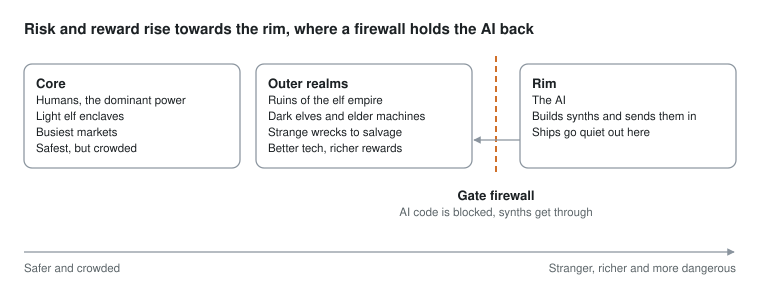

# Space game design foundation

The original design brief for Galaxus, kept here as markdown so it lives with the code. The lore bible (docs/lore-bible.md) builds on it; where the two differ, the lore bible is newer.

## Overview

This is a PC space game in the spirit of Frontier: Elite II, with X-Wing style flight. You play an independent captain who trades, takes missions and picks sides in a galaxy that keeps running without you.

- Platform: PC only (Windows, Linux, Mac). No browser or mobile build.
- Core loop: fly, trade, take missions and build reputation with factions.
- Scale: most systems are empty, with hundreds of factions and millions of generated missions and NPCs.
- Undertone: an AI at the galaxy's rim, held back by a firewall built into the gate network.
- No walking about. Everything happens from the cockpit, the station screens and the news feed.

## Setting and lore

The elf empire fell long ago out at the rim. Humans now run the galaxy from nearer the core, using technology they inherited and don't fully understand.

- **Elves** are the elder race. Their empire covered the outer realms, and they built the gate network everyone still uses.
- **The fall.** The AI is the obvious suspect, but nobody alive knows the full story, and the light elves aren't saying.
- **Humans** are newer and live closer to the core, though still ancient by any normal measure. They're the dominant power now.
- **The firewall.** Gates nearer the centre filter out AI code, so the AI can't cross them. It may have been the elves' last act, and it may not hold for ever.
- **The AI** sits beyond the firewall at the rim. It can't come inward itself, but it can build synths and send them.

Travelling outward means better tech, richer rewards and stranger missions, along with ships that go quiet and signals nobody can explain. The core is safer but crowded and politically tense.

The AI stays offscreen for most of the game. Players feel it through synths, missing ships and rumours, and it only comes into focus late on.

The idea of an AI at the rim echoes Vernor Vinge's *A Fire Upon the Deep*. The firewall and the synths are what make our version different.

## Races

A small set of core races is written by hand to carry the story, and everything else is generated. The player is always human. The other races shape play through hired crew, the ships they build and the NPCs you deal with.

| Race | Where they live | Character | Gameplay effect |
| --- | --- | --- | --- |
| Light elves | Among humans, nearer the core | Proud, diminished survivors of the fall who guard what they know about it | Ships recharge faster near stars; low g-tolerance |
| Dark elves | The ruins of the old empire at the rim | Stayed behind; nobody knows if they survived by being tough or by making a deal | Better sensors and stealth in shadow; suffer near bright stars |
| Humans | Closer to the core | The dominant power, running gates they don't fully understand | Biggest markets and navies; baseline pilot |
| Orcs | Heavy-gravity worlds | Strong, dense-boned and short-tempered | High g-tolerance; more power to engines |
| Dwarves | Hollowed-out asteroids | Miners and shipbuilders | Best ship building, repair and mining |

Synths and robots are covered under machine civilisations.

Minor races are generated from trait sets: home environment, body type, temperament, tech level, lifespan and attitude to machines and AI. Each gets its own naming grammar. There can be dozens or hundreds of them, most living in a handful of systems.

## Machine civilisations

Machines come in tiers by age, from relics of the elf empire to robots crewing human ships today. The question running through every tier is which ones the AI has already reached.

1. **Elder machines.** Built during the elf empire, and nobody now knows by whom or why. Some still carry out old tasks such as tending gates, maintaining dead worlds or guarding things. Some are dormant. Even the elves won't say whether they made them.
2. **Free machine civilisations.** Robots that broke away so long ago that their origins are myth, even to them. They have their own systems, culture and politics, and trade with everyone while trusting no one.
3. **Machines inside other societies.** Robots and androids working as crew, labourers and soldiers. Treatment varies by race: property to humans, crafted kin to dwarves, and beneath notice to orcs.
4. **Synths.** Minds in built bodies. They're people, but their legal standing is never quite settled. They don't need air or food, which changes their range and cargo space but gets them hassled at human ports.
5. **Rim-made synths.** The AI's agents, indistinguishable from other synths. Nobody can tell which synths are free, synths included.

This gives us machine rights as a faction issue, elder machines to bargain with or salvage, and free machines who may know how the elf empire fell.

## Factions

There are hundreds of factions, most of them small, sitting on top of the races. Many mix races, which is where the politics gets interesting.

- **Types:** nations, noble houses, mining corporations, guilds, cults, pirate clans and machine collectives.
- **Tiers:** hundreds of one- or two-system clans and outfits, a few dozen regional powers and a handful of great powers. That keeps the politics readable while the galaxy still feels crowded.
- **Traits drive behaviour.** Each faction's traits feed straight into the simulation's expand, mine, trade and war decisions. A greedy dwarf mining guild and a paranoid elf house behave differently without any extra scripting.
- **Factions change over time.** They split after civil wars, merge through alliances, get absorbed or die out. The galaxy at year 50 should look different from year 1.
- **The player picks sides.** Reputation with each faction decides which ports you can dock at, what prices you get and which missions you're offered.

## Ranks

You can rise through the ranks of the core powers, such as human nations and light elf houses. Outer civilisations like the dark elves and free machines never fully accept outsiders. You can work for them, but associate is the highest standing you'll get.

Core powers use a full ladder. These titles are placeholders, and each power will have its own.

1. **Unknown:** public jobs only.
2. **Contractor:** regular missions and standard docking.
3. **Trusted:** restricted cargo and better pay.
4. **Commissioned:** military missions, ships and equipment.
5. **Honoured:** access to restricted systems, and a higher influence factor in that power's wars.

Outer civilisations stop at associate.

1. **Stranger:** trade only, and docking is often refused.
2. **Tolerated:** basic missions.
3. **Associate:** their full mission board, markets and research help, plus rumours about the fall.

Rising with one power costs standing with its rivals. Rank can also be lost through crimes or betrayal.

## Law and the underworld

Each power has its own law and its own enforcers, and law gets thinner the further out you go. Underneath it is an underworld you have to discover, and your reputation in it is local to the systems where people know you.

**Law enforcement**

| Enforcer | Where | What they do |
| --- | --- | --- |
| System police | Core and settled systems | Patrol stations and space lanes, scan cargo, issue fines and attack the wanted |
| Gate wardens | Every gate | Scan for contraband and rim tech at the firewall |
| Synth registry agents | Human space | Check synth papers and hunt suspected rim-made synths |
| Faction navies | Borders and war zones | Enforce blockades and war law |
| Guild and corporate security | Mining claims and convoys | Protect their owners' property, often heavy-handedly |
| Bounty hunters | Anywhere | Independent, and chase wanted captains across jurisdictions |
| Local strongmen | Outer realms | Whatever passes for law out there |

What's illegal varies by power. Synth crew might be banned in some human systems, rim tech is restricted near the core, and elf artefacts need permits in light elf space.

**Two separate standings per region**

- **Legal status:** clean, fined, wanted or hunted. It only applies within that power's space, unless powers share a treaty.
- **Underworld notoriety:** unknown, known, respected or feared. It's earned through jobs and spreads slowly through rumour, so you can be a name in one cluster and nobody two systems away.

**The underworld**

Criminal organisations are factions in the simulation: smuggling rings, pirate clans, fences, assassins, information brokers and black-market labs that research rim tech. Their bases are hidden on moons, in asteroid fields, on derelict stations or in the shadow of gas giants, and they never appear on the public nav map.

**Discovering them**

Hidden locations are found through clues rather than handed out.

- Rumours from bar NPCs and your own crew
- Intercepted comms and odd scan readings
- Following smuggler ships to see where they go
- Doing jobs for a low-level contact who then trusts you with coordinates

Notoriety opens the next door. Low notoriety gets you street contacts, higher notoriety gets you invited to the hideout moon, and the top level gets you into the inner circle. The same clue system works the other way for bounty hunting, where you track a wanted NPC to their hideout.

## Galaxy simulation

The galaxy keeps running whether or not the player is there. Most systems start empty, and factions push into them to survey, claim and mine.

**System states.** A system moves from unsurveyed to surveyed, claimed, mining outpost and colony. Along the way it can become contested, abandoned or ruined. Factions expand using real NPC survey and mining ships, which the player can escort, raid or race.

**Faction behaviour.** Each faction has resources, needs, aggression and grudges. On every simulation tick it decides whether to expand, mine, defend or push on a rival.

**Escalation ladder.** Conflicts climb one step at a time, and each step has odds of going up or down. That gives plenty of small squabbles and the occasional big war.

1. Dispute
2. Raids
3. Blockade
4. Open war

**Random events** shake things up so no two playthroughs go the same way. Examples include a rich mineral strike, a plague, a rim incident or a coup.

## Player influence

Every outcome is a weighted roll, and the player's share of the weight shrinks as the mission's scale grows. Small jobs are yours to win or lose, but big battles and wars turn on factors far bigger than one captain.

| Mission scale | Player influence |
| --- | --- |
| Courier or small job | You decide it |
| Skirmish | High |
| Fleet battle | You shift the odds a bit |
| A whole war | Tiny per mission, but it adds up over many missions |

Rank and reputation raise your influence slowly over the game. Even late on, a war can be lost while you fought well, and the news feed should say so.

## Missions and NPCs

Missions come out of the simulated world rather than a random table, so every one has a reason and the player's choices shift the galaxy. Millions of missions are easy to generate. The work is in stopping them feeling samey.

- **Missions from needs.** A famine creates delivery runs. A border war creates escort, raid and smuggling jobs. A mining rush creates survey and claim-jumping work.
- **Complications.** The client lies, the cargo is stolen, a rival bids for the same job, or the passenger is a fugitive. A few dozen mission types multiplied by these twists gives huge variety.
- **NPCs with wants and memory.** Each NPC comes from a seed: a name in their race's style, traits, a secret, loyalties and relationships. Recurring NPCs who remember what you did are what make it feel alive.
- **Race voices.** Mission text is built from phrase grammars written separately for each race, so an orc contract reads differently from an elf one.
- **Arcs.** Some jobs lead to follow-ups, and a few lead into the main plot about the gate network and the AI.
- **Seeded.** The galaxy, NPCs and missions regenerate from seeds. Saves only hold what the player has changed.
- **News feed.** Generated text news shows what happened in the galaxy and why, for example: "The 3rd Fleet broke at Kessa despite a daring strike on its carrier."

AI is used while building the game, not inside it. Claude writes large banks of phrases, names and complications for each race, which ship as data files. The game stays small and runs on anything.

## Flight and combat

Flight uses X-Wing style handling for dogfights, with an option for true Newtonian flight. Frontier's pure Newtonian combat was awkward for a lot of players, so it isn't the default.

- **Flight assist on** gives X-Wing handling: a top speed, a throttle and fixed turn rates.
- **Flight assist off** gives Newtonian drift for skilled players.
- **Cruise or jump drive** covers long distances inside a system and between systems.
- **Power distribution** moves power between engines, shields and weapons. This is the core combat decision.
- **Crew and builder effects:** light elf ships recharge faster near stars, orc engines take more power, synth crew can overclock systems, and each NPC pilot's g-tolerance caps their turn rate.

## Ships and equipment

Ships are defined as data, so new hulls, brands and parts can be added at any time without code changes. The core worlds have known manufacturers, and the outer realms have strange ships and equipment you can salvage and research.

**Hulls and slots.** Each ship is a hull with slots for engines, a power plant, shields, weapon hardpoints, sensors, cargo and utility gear. Hull classes include couriers, freighters, fighters, gunships, explorers and miners. Upgrades are parts fitted to slots, and the power plant sets the budget that power distribution shares out.

**Crew.** The player is always human and flies small ships solo. Bigger hulls have crew berths, which you fill by hiring from any race. Crew bring their race's strengths, such as an orc engineer getting more out of the engines or a dark elf on sensors.

**Crew personalities.** Every crew member is generated from a seed, like other NPCs, with their own personality and loyalty. Most are ordinary. A few are real gems, and a few are moaners who leave when conditions aren't right.

- **Profile:** race, skills, traits, quirks, a short backstory and what they want from the job.
- **Loyalty** moves with pay, ship comfort, danger, success, how they get on with the rest of the crew and whether your choices clash with their values. An elf might hate carrying rim tech, and an orc might get restless without a fight.
- **Leaving:** when loyalty drops, they grumble first, then make demands, then quit at the next port. A badly treated crew member might steal, sell information or start trouble on the way out.
- **Thresholds vary.** Moaners have short fuses. Gems put up with a lot, get better over time and become more loyal the longer they stay.
- **Rare finds:** the best crew turn up in odd places, such as outer realm bars, rescued escape pods or wrecks.
- **Crew relationships:** crew like or dislike each other by race and traits, so who you hire affects the mood on board.
- **Chatter:** generated lines in each race's voice for complaints, stories and reactions to what just happened.

**Core-world builders.** Each one has its own look and stat bias.

| Builder | Style | Bias |
| --- | --- | --- |
| Human corporate yards | Plain and mass-produced | Reliable all-rounders, with parts available everywhere |
| Dwarf yards | Heavy and armoured | Tough and easy to repair, but slow |
| Light elf houses | Slender and efficient | Solar recharge and speed, but fragile |
| Orc yards | Crude, with oversized engines | Raw speed and power, weak shields |
| Free machine foundries | Odd, crewless designs | Efficient with no life support, distrusted at ports |

**Names.** Brand and model names are generated, with a naming grammar for each manufacturer. The list can keep growing as we go.

**Unknown ships.** Out at the rim, many ships have no name anyone knows. They show up by description, such as "unidentified elder hull" or "rim-pattern drone", until you scan, salvage or research them. Then they get a designation, or you name them yourself.

**Equipment grades.** Standard parts come in marks I to V, alongside rare parts and one-off finds.

**Salvage and research.** The further out you go, the stranger the wrecks and artefacts. Research at a friendly station turns them into usable equipment: dwarves for hardware, light elves for elder tech and free machines for machine tech. It costs time, money and reputation, and results can come with side effects.

**The catch.** Rim tech may carry AI code. Bringing it inward could be how the firewall fails, which ties salvage into the main plot.

**Art.** Ships are flat-shaded low-poly models assembled from modular parts, so new variants are cheap to make.

## Tech and platform

The game is built in Godot 4 (.NET edition) with C#, aimed at running on almost any PC.

- **Engine:** Godot 4 .NET with the Compatibility renderer (OpenGL 3.3), so it runs on ten-year-old laptops and integrated graphics.
- **Language:** C# for all game code.
- **Look:** rendered at a low resolution such as 640x360 and scaled up with sharp pixels, using flat-shaded low-poly art and no post-processing. (Since changed: screens are laid out at 640x360 but drawn at full resolution, because the text was too hard to read.)
- **Builds:** Windows, Linux and Mac. The Linux build covers the Steam Deck.
- **Input:** keyboard, mouse, gamepad and flight sticks.
- **Content as data:** races, factions, ships, parts and phrase banks live in data files, so we can keep adding to them.
- **Distribution:** a small download with no installer, on itch.io first and Steam later if it gets traction.
- **Source:** a GitHub repo from day one, so work carries over between sessions.

## First milestone

The first milestone is one ship you can fly with X-Wing handling and power distribution. It's the core of the game, so it's worth getting the feel right before building anything else.

- [x] Set up the GitHub repo and Godot 4 .NET project
- [x] Set up the low-resolution render pipeline and flat-shaded look
- [x] Make one flyable ship with throttle, pitch, roll and yaw
- [x] Add flight assist on and off
- [x] Add power distribution between engines, shields and weapons
- [x] Add a target drone to shoot at
- [x] Support keyboard, mouse and gamepad

## Open questions and answers

Answers come from comments on the original brief.

| Question | Answer |
| --- | --- |
| What's the game called? | Galaxus. |
| Are orcs and dwarves offshoots of humans, or races in their own right? | Not explained, and nobody in the galaxy knows. Possibly experiments from the past, perhaps entirely different races or aliens. |
| Does the player choose their race at the start, and can they change ship crew later? | The player is always human. You can hire crew once you have a ship with room for them. |
| How many star systems should the galaxy have? | A realistic amount, like Frontier: a ridiculous number. |
| How does the main plot end, and does the firewall fail? | A slow takeover of the core human races by the AI and synths, like a slow losing battle. It's set off later on, once the player can reach outer realm messages, which needs better ships and longer-range jumps. |
| Should the data files be open to modding? | Yes, definitely. The whole game is likely to be open source, which leaves plenty of room for more civilisations given how many planets there are. A mechanism for this can come later. |
